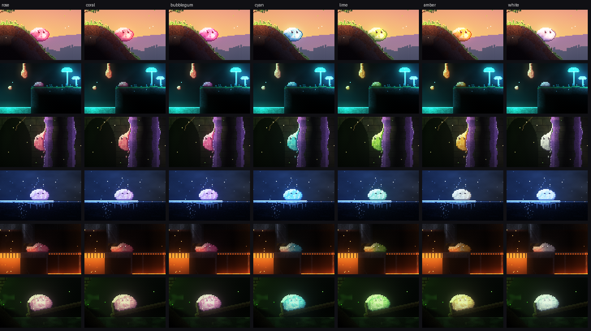

# 02 Art direction

The look: crisp pixels, a lit simulated layer over a dim back wall, and colour that comes from light and from things that glow rather than from saturated textures. Moody by default: most of every screen is dark, and the light tells you where to look.

Everything below can be seen in `prototypes/00-stills`: one shot per world ([11 Worlds](11-worlds.md)) and a sheet of Bob's states, with controls for Bob's colour and for looking at the light on its own. The [concept doc](https://thesnwmn.github.io/pixelbob/03-concept/) shows them with the logo, menus and HUD.

## Two renderers, one look

- **The stills** (`prototypes/00-stills/src/kit/`) are a CPU renderer for authored shots: scenes are painted pixel by pixel in code and lit with the lighting model below. They're for deciding how the game should look before the game can make it.
- **The game renderer** (`packages/render`) is the same model on the GPU, fed by the simulated world (`shade.ts` turns cells into its textures).
- **Bob is the same in both.** The stills drop the real goo Bob (`packages/bob`) into a throwaway sim world built from the shot's own pixels, play him a second or two of input, and paint his particles with the game's own painter (`paintBob` in `packages/bob/src/draw.ts`). Every Bob in every still is a shape the game can actually make.

If the two drift apart, change both, or decide which one is right and say so here.

## Camera and pixel scale

- **Camera: 320×180 world pixels.** The shots are authored at exactly that size, so a shot *is* a game screen.
- **Bob is about 20 px across** (about 280 particles, one per pixel of him): a sixteenth of the screen width. Small enough that the world reads as big and dangerous, big enough to see him squash, lean, hang and drip. The first stills compared 480, 320 and 240 wide; 320 kept the room around him without losing him.
- **One world pixel = one simulated cell.** No sub-cell art. Detail comes from more cells, not finer sprites.
- **Integer scaling on device pixels.** Choose the scale that makes the camera closest to 320 wide, then let the camera size flex a little to fill the screen rather than letterboxing or blurring. On a 1920×1080 laptop that's 6×. On a phone in landscape (about 2532×1170 device pixels) it's 7×, giving a 361×167 camera.
- **Camera zoom as a game tool**: pull out in big caverns or when Bob is split, push in for tight squeezes. Only ever by whole-pixel steps.

## Layers

| Layer | Lit? | Simulated? | Notes |
|---|---|---|---|
| Backdrop (sky, distant hills) | No | No | Painted parallax, colour-graded for depth |
| Back wall | Yes, dimmer | No (diggable later?) | What you see through tunnels; catches light halos; never pitch black, so open space always reads against rock |
| Play layer: solids | Lit at the surface, fading inside | Yes | Light seeps a few pixels into a surface before it fades to near black |
| Play layer: fluids, plants, Bob | Yes | Yes | Translucent fluids, plants on springs |
| Emission + bloom | Adds light | — | Fire, goo, lava, mushrooms, crystals, sparks, hot Bob |

## Lighting model

1. Every cell has an **albedo**, optional **emission**, and **blocks light** by a material amount (rock about 0.55 per cell; inside solids it counts for half, so light bleeds a few pixels into surfaces).
2. **Sky light** is traced along five rays (straight up, two slight tilts and two steep ones so the sides of things catch the sky). **Point lights** (lamps, fire, mushrooms) are traced with soft shadows. Both on a half-resolution grid.
3. **Solids fade with depth** from their nearest open surface to a dim ambient: bright rims, dark interiors.
4. **Emission glows twice**: as light on its surroundings (a blurred emission field) and as **bloom**, at two scales.
5. **Grade**: soft highlight roll-off, per-world tint, vignette, and a very light ordered dither so gradients stay pixel-y.

Decided while making the shots:

- **Emitters never shadow themselves.** A mushroom's light sits under its cap.
- **Bob gives off a little of his own colour.** Under strong coloured light (teal caves, orange foundry) his albedo alone goes grey or blows out. A small floor of his own colour keeps him readable; hot Bob gets more because he glows.
- **The dark is the default underground.** Caves are lit by what's in them. Gameplay-critical things (Bob, lost bits, hazards, tacky walls) must be lit or glow; everything else may fall into shadow.
- **Editor work light.** The sandbox uses near-flat lighting so you can see what you're building, with a toggle to preview real lighting.

## Palette

Material ramps live in `prototypes/00-stills/src/kit/materials.ts` and `packages/sim/src/materials.ts` (the same colours): 3–4 colours per material, picked per pixel by hash for grain.

- **Terrain is low saturation and dark.** Saturation is reserved for Bob, emitters, hazards and anything you can interact with.
- **Colours are a language.** A player who has learned them can read a room before touching it:

| Colour | Means |
|---|---|
| Green moss | Grippy ground: rolls up slopes too steep for rock |
| Amber resin | Holds you if you push in |
| Violet gum | Holds you on a sheer wall |
| Pale blue | Ice: no grip, and cold |
| Orange, red, yellow | Heat: lava, fire, molten metal. Danger, and also how you melt |
| Steel grey teeth | Spikes: they cut you |
| Teal glow | Light, and glow goo |
| Toxic green | Gas and acid: it hurts |

- **Each world has a two-colour light story** ([11](11-worlds.md#the-run)): warm against cool, and the warm one is usually where the heat is.
- **Hazards are hot colours.** Bob must never be confused with one. Hot Bob turning orange near lava is the one deliberate exception, because that *is* the danger signal.

## Bob's look

- **Goo, drawn from his particles.** A smoothed density field over his particles gives one jelly with a fizzy edge; torn-off bits are drawn the same way, and stray particles show as specks.
- **Translucent jelly:** inside blends about 80% over what's behind him; the rim is opaque and darker.
- **Lit from the top-left:** a specular arc and a lighter glow near his base, as if light passes through him.
- **Hugs terrain:** his pixels never draw inside solids, so his base takes the shape of what he sits on.
- **Temperature shows continuously:** cooler goes icy and, frozen, faceted like cut glass; hotter goes orange and glows, and runny he's more see-through.
- **Eyes:** two dark pixels-tall eyes with a glint, on the piece you steer (a bit with no eyes isn't "you"). They squint when frozen and droop when runny, and look where he's going.

## Bob's colour

**Rose pink** (`#ff6a92`; `BOB_COLORS.rose` in `packages/bob/src/draw.ts`).

Decided by a study: every shot rendered with every candidate, cropped on Bob (`img/bob-colours.png`).

- **Pink, because nothing else is pink.** Nature here is green, brown and blue; light is teal and amber; hazards are orange, red and toxic green; tacky surfaces are green, amber and violet. Every other candidate vanishes into some world: cyan into ice and teal glow, lime into moss and gas, amber into sun, lava and resin, milk into snow.
- **Rose, not coral or bubblegum.** Coral (the old default) leans orange and sits closest to fire and lava in the Foundry. Bubblegum leans magenta and drifts towards the violet gum and crystals in the Ruins and the Caverns. Rose sits between them.
- **Pink's weak spot is teal light**, which turns it grey-mauve (the Caverns' lost bit). Bob's self-light floor fixes him; lost bits there want a little light of their own.

Gameplay changes his colour without changing who he is, and the rose stays underneath:

- **Temperature** already tints him: icy blue and faceted when frozen, molten orange and glowing when runny.
- **Absorbing** (planned) would tint him: watery blue and see-through when swollen, teal when glowing, dark and glossy when oily.
- **Players can pick another colour** in settings (accessibility), from the same set.

## Shots

| Shot | World | Shows |
|---|---|---|
| The Green | 1 | Golden hour. Bob rolls downhill (leaning into it) towards a moss ramp up to a ledge with a lost bit glinting on it |
| Glow Caverns | 2 | Runny from a hot spring, Bob hangs on a thread from a ledge over a glowing pool, reaching for a lost bit below; an earlier drop is falling |
| Sticky Ruins | 3 | Bob, a drop of goo, halfway up a violet gum pillar in a sun shaft; an amber resin route glows to one side; a lost bit on top |
| Frozen Grotto | 4 | Moonlit lake: frozen, faceted Bob has frozen a road of ice across the water; a campfire on the far bank to thaw at |
| The Foundry | 5 | A piece of Bob holds a pressure plate; the signal opens a gate; runny from a vent, the rest of him pours under it towards the exit |
| The Sump | 6 | A swollen, watery Bob (absorbing isn't built: he's a bigger Bob in watery colours) tips a log see-saw to lift a lost bit to a ledge; gas glows, methane flares |
| Bob's states | — | Nine real poses: idle, rolling, jumping, pouring under a slot, hanging on a thread, climbing gum, frozen and cracked, cut by spikes, a hot puddle |

## Still to settle

1. How dark is too dark on a phone in daylight? The shots are tuned on a monitor.
2. Is the back wall diggable or simulated, or decoration only?
3. Bloom on big glowing pools: lovely, but heavy.
4. A painted parallax backdrop in the game renderer (the stills have one; the game has a gradient).
5. Plants on springs (grass, vines) in the game renderer: the stills sway them; the game's are cells.

## Logo, menus and HUD

Mocked up in the concept doc (`prototypes/03-concept`):

- **Logo**: carved, moss-topped stone letters lit warm from above and teal from below; the O of BOB is Bob himself, the real goo, sitting in the gap.
- **Menus** are a dark glass panel and a pixel font (Silkscreen) over the live game, never a separate screen. Rose marks the selection.
- **HUD**: how much of Bob you still have (the score), a temperature strip from icy to molten, and his pieces with the one you steer ringed. It fades when nothing changes.
- **Level complete** shows the % of Bob that made it, lost bits found and crumbs shed.
- **Tips** are one line in the world when something new happens to Bob. Never a tutorial screen.
