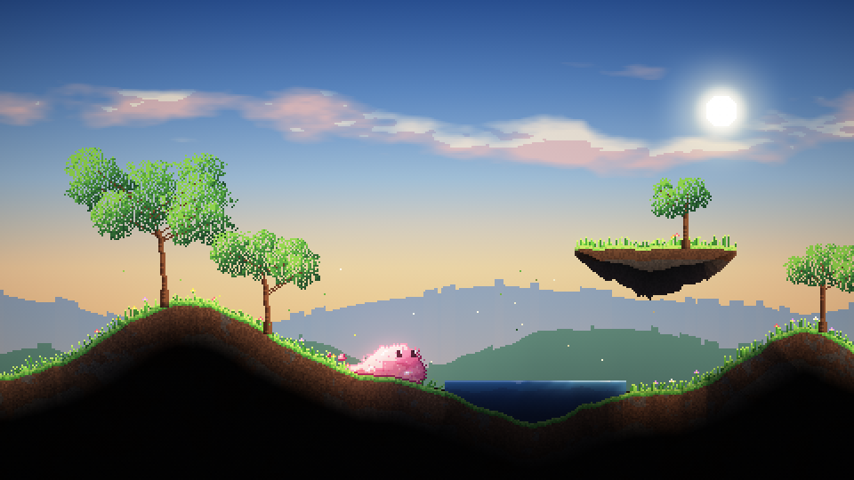
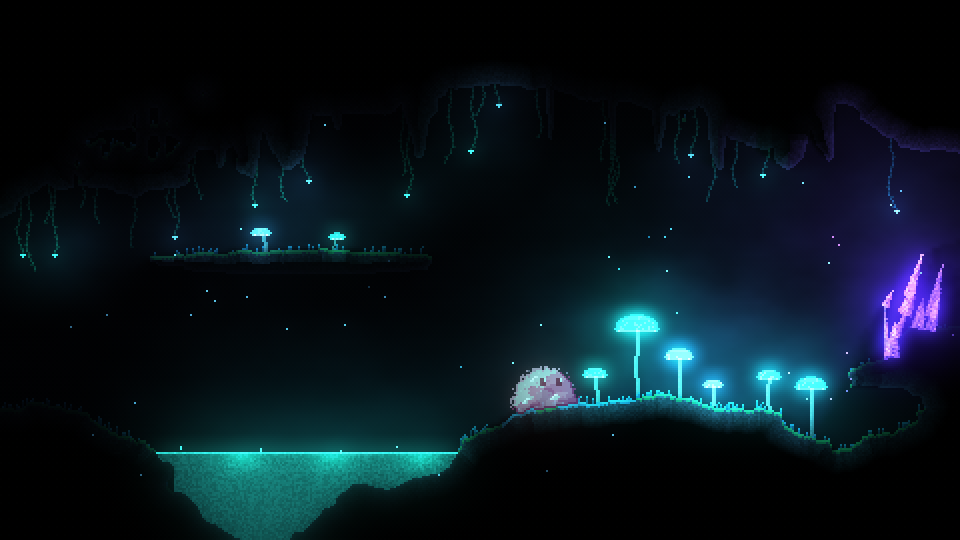
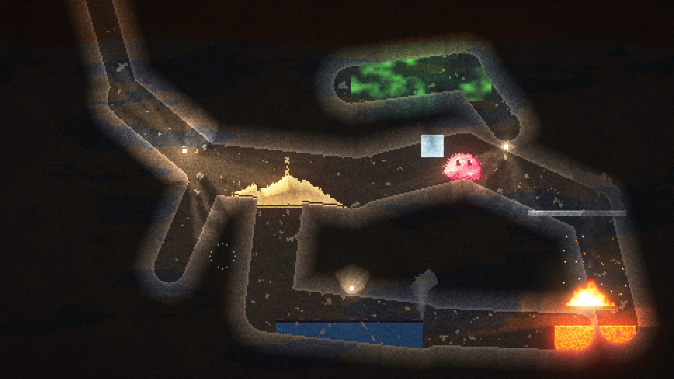

# Pixelbob: design notes

A 2D side-on platformer where **everything is made of simulated pixels**, including the hero: Bob, a squishy blob who can squeeze through gaps, split apart and pull himself back together. Materials behave physically (rock holds, sand pours, water flows, gas drifts, fire dances), and they change Bob: cold makes him brittle, heat makes him runny.

Target: web browser first, on phones and laptops.

## TL;DR

```
 ┌───────────────────────── one fixed 60 Hz step ─────────────────────────┐
 │                                                                         │
 │  World grid (cellular automaton)        Bodies (particles + bonds)      │
 │  one material per cell: rock, sand,  ◄─► Bob, debris, ropes, canopies   │
 │  water, gas, fire… + temperature        XPBD constraints, shape memory  │
 │  chunked, only "awake" chunks update    bond stiffness from temperature │
 │                                                                         │
 └──────────────────────────────┬──────────────────────────────────────────┘
                                ▼
   Renderer (WebGL2): cells → texture, emissive → lights + bloom, back wall, parallax
```

- **Two simulations, tightly coupled.** A falling-sand style grid for the world, and a particle system with breakable bonds for things that must hold a shape (Bob above all). Bob is a few hundred particles, one per pixel. See [03 Simulation](03-simulation.md).
- **One idea drives Bob's states.** Temperature changes his bond settings. Hot: weak bonds, little shape memory, so he puddles and drips. Cold: stiff bonds that break at small stretch, so he shatters. Splitting is bonds breaking; merging is bonds re-forming on contact.
- **Look:** crisp unfiltered pixels, a lit and simulated play layer over a dim back wall, emissive materials feeding soft lights and bloom. Default camera about **320×180 world pixels**, with Bob about 30 px wide. See [02 Art direction](02-art-direction.md) and the stills.
- **Stack:** TypeScript, Vite, pnpm workspace, WebGL2, Vitest, Playwright. Static site on GitHub Pages with a preview per PR. See [04 Tech and toolchain](04-tech-and-toolchain.md).
- **Plan:** stills (this PR) → material sandbox → Bob playground → first level. See [05 Roadmap](05-roadmap.md).

## Documents

| Doc | What's in it |
|---|---|
| [01 Game overview](01-game-overview.md) | Pillars, Bob's abilities, material interactions, biomes, puzzle seeds, controls |
| [02 Art direction](02-art-direction.md) | Camera and pixel scale, palette, lighting model, Bob's look, what the stills are asking |
| [03 Simulation](03-simulation.md) | World grid, materials data model, temperature, Bob as a soft body, coupling, performance budget |
| [04 Tech and toolchain](04-tech-and-toolchain.md) | Language, build, rendering, threads, hosting and previews, testing, level format, input |
| [05 Roadmap](05-roadmap.md) | Phases, what each prototype must prove, PR plan |
| [06 Prior art](06-prior-art.md) | Games and toys to learn from |
| [07 Materials](07-materials.md) | Every material in the sim and what it reacts with, plus a backlog of ideas |

## The stills

`prototypes/00-stills` renders six concept screens procedurally with the lighting model we intend to ship: meadow, glow cavern, foundry, frozen grotto, a sheet of Bob's states, and a mockup of the sandbox. They animate (wind, fire, spores, Bob breathing), and there are controls for Bob's colour, camera zoom and light views. Run `pnpm dev:stills`, or open the GitHub Pages preview.

| | |
|---|---|
|  |  |
|  |  |
|  |  |

These PNGs are the whole 480×270 still at 2× (the page defaults to the closer 320×180 camera). Regenerate them with `node prototypes/00-stills/scripts/render.ts docs/img 2`.

