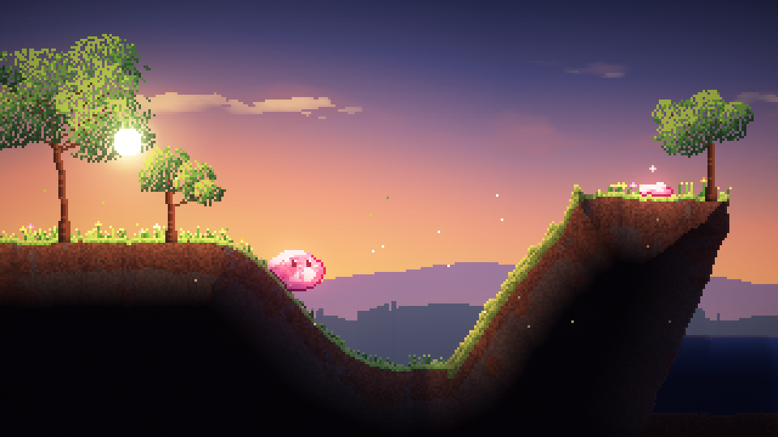
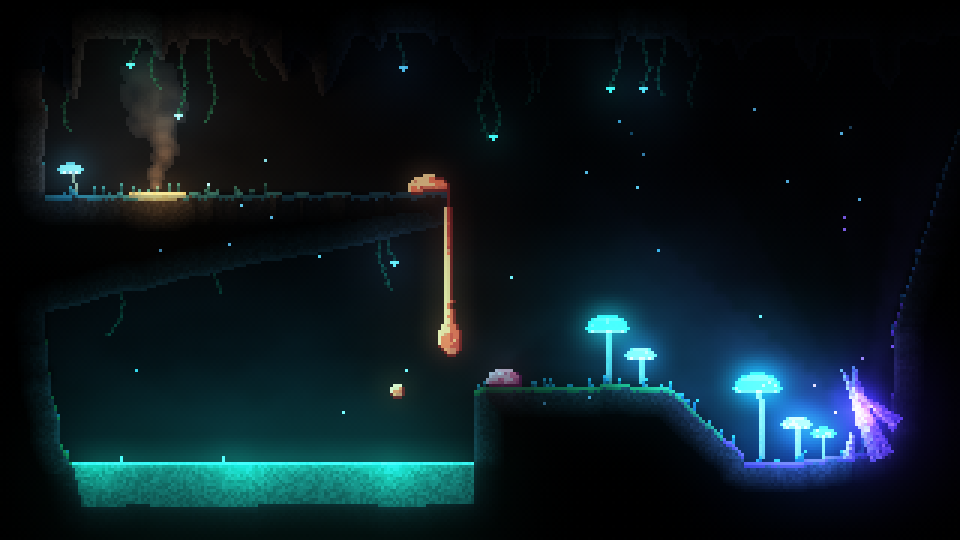
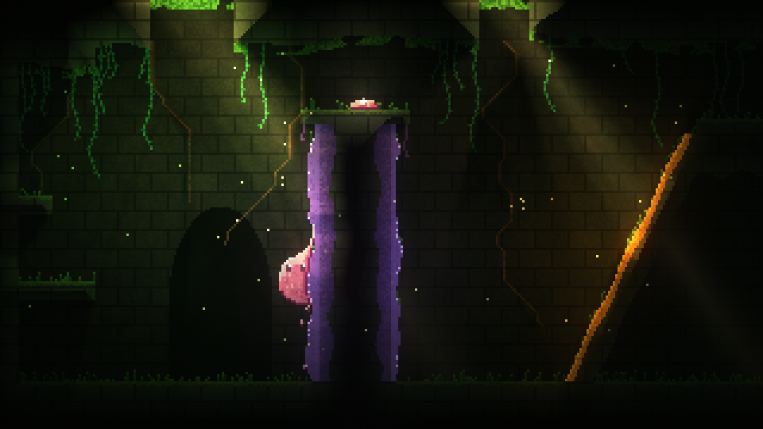
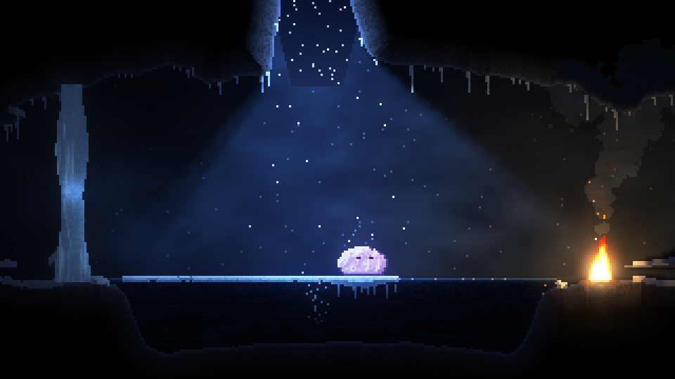
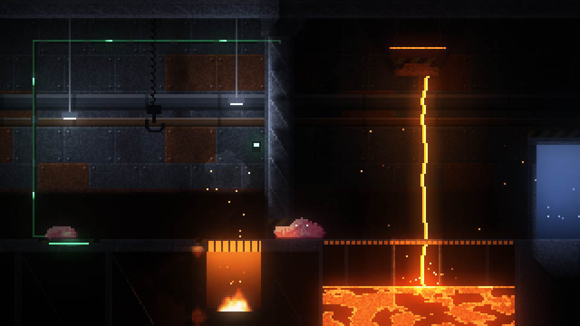
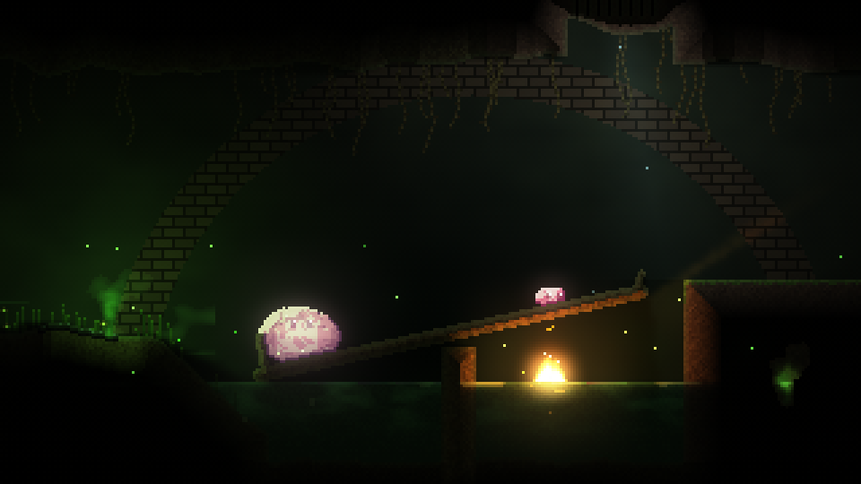
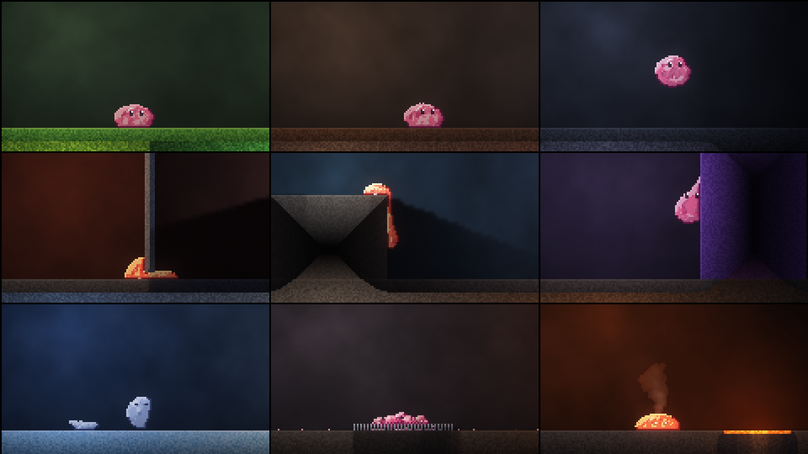

# Pixelbob: design notes

A 2D side-on platformer where **everything is made of simulated pixels**, including the hero: Bob, a squishy blob who can squeeze through gaps, split apart and pull himself back together. Materials behave physically (rock holds, sand pours, water flows, gas drifts, fire dances), and they change Bob: cold makes him brittle, heat makes him runny.

Target: web browser first, on phones and laptops.

## TL;DR

```
 ┌───────────────────────── one fixed 60 Hz step ─────────────────────────┐
 │                                                                         │
 │  World grid (cellular automaton)        Bodies (particles)              │
 │  one material per cell: rock, sand,  ◄─► Bob: goo, a viscoelastic fluid │
 │  water, gas, fire… + temperature        pressure, tension, springs      │
 │  chunked, only "awake" chunks update    that flow; heat turns the knobs │
 │                                                                         │
 └──────────────────────────────┬──────────────────────────────────────────┘
                                ▼
   Renderer (WebGL2): cells → texture, emissive → lights + bloom, back wall, parallax
```

- **Two simulations, tightly coupled.** A falling-sand style grid for the world, and particles for Bob. Bob is about 280 particles, one per pixel, behaving as goo: a viscoelastic fluid with pressure, surface tension and springs that stretch, flow and snap. See [03 Simulation](03-simulation.md) and [08 Bob](08-bob.md).
- **One idea drives Bob's states.** Temperature turns his knobs continuously, never swaps a shape. Hot: his springs flow and he's sticky, so he puddles, pours, dangles and drips. Cold: stiff, and frozen he's rigid and cracks if dropped. Splitting is springs snapping; merging is springs forming on contact.
- **Look:** crisp unfiltered pixels, a lit and simulated play layer over a dim back wall, emissive materials feeding soft lights and bloom. Default camera about **320×180 world pixels**, with Bob about 20 px wide and rose pink. See [02 Art direction](02-art-direction.md) and the shots below.
- **Stack:** TypeScript, Vite, pnpm workspace, WebGL2, Vitest, Playwright. Static site on GitHub Pages with a preview per PR. See [04 Tech and toolchain](04-tech-and-toolchain.md).
- **Worlds:** seven, each teaching one new thing, from the meadows on the surface down to the core. See [11 Worlds](11-worlds.md).
- **Plan:** stills → material sandbox → Bob playground → concept → agent harness → first slice. See [05 Roadmap](05-roadmap.md), and the [concept doc](https://thesnwmn.github.io/pixelbob/03-concept/) for the whole picture.

## Documents

| Doc | What's in it |
|---|---|
| [01 Game overview](01-game-overview.md) | Pillars, Bob's abilities, material interactions, biomes, puzzle seeds, controls |
| [02 Art direction](02-art-direction.md) | Camera and pixel scale, lighting model, the colour language, Bob's look and colour, the shots |
| [03 Simulation](03-simulation.md) | World grid, materials data model, temperature, Bob as a soft body, coupling, performance budget |
| [04 Tech and toolchain](04-tech-and-toolchain.md) | Language, build, rendering, threads, hosting and previews, testing, level format, input |
| [05 Roadmap](05-roadmap.md) | Phases, what each prototype must prove, PR plan |
| [06 Prior art](06-prior-art.md) | Games and toys to learn from |
| [07 Materials](07-materials.md) | Every material in the sim and what it reacts with, plus a backlog of ideas |
| [08 Bob](08-bob.md) | How Bob is built and moves (every action is him deforming), temperature states, tearing and rejoining, and what every material does to him |
| [09 Bob models](09-bob-models.md) | Why Bob is goo: the three models that were built and compared, and what was learned |
| [10 Ideas](10-ideas.md) | Gameplay and other ideas raised along the way that aren't built yet |
| [11 Worlds](11-worlds.md) | The run of worlds: what each teaches, its materials, heat and light, and its shot |

## The shots

`prototypes/00-stills` renders one shot per world at the 320×180 game camera, plus a sheet of Bob's states, with the lighting model we intend to ship. Every Bob in them is the real goo, simulated into his pose. They animate (wind, fire, spores, snow), and there are controls for Bob's colour and the light views. Run `pnpm dev:stills`, or see them in the [concept doc](https://thesnwmn.github.io/pixelbob/03-concept/).

| | |
|---|---|
|  |  |
|  |  |
|  |  |



Regenerate them with `node prototypes/00-stills/scripts/render.ts docs/img 3`.
